# Assignment 2: Application Load Balancer on AWS

For this assignment I put two EC2 web servers behind an Application Load Balancer (ALB). The goal was simple to say and surprisingly fiddly to build: **all traffic goes through the ALB, and the servers themselves can't be reached directly from the internet.**

I built it by hand in the AWS Console, in **eu-west-2 (London)**. This README walks through what I did, in the order I did it, and *why* each piece is there.

## What I built

```
                 Internet
                    |
              HTTP :80 (anyone)
                    v
        +-----------------------+
        |   web-alb  (alb-sg)   |   <- sits in public-subnet-a AND public-subnet-b
        +-----------------------+
                    |
          HTTP :80 + health check on "/"
                    v
             Target group: web-tg
              /                \
   web-server-1              web-server-2
   eu-west-2a                eu-west-2b
   (ec2-sg: port 80 ONLY from alb-sg)
```

| Piece | Name | Notes |
|---|---|---|
| VPC | `alb-project-vpc` | `10.0.0.0/24` |
| Subnet A | `public-subnet-a` | `10.0.0.0/26`, eu-west-2a |
| Subnet B | `public-subnet-b` | `10.0.0.64/26`, eu-west-2b |
| Internet gateway | `my-igw` | attached to the VPC |
| Route table | `route-table-alb` | `0.0.0.0/0` goes to `my-igw`, linked to both subnets |
| Security group | `alb-sg` | HTTP 80 from anywhere |
| Security group | `ec2-sg` | HTTP 80 only from `alb-sg` |
| Instances | `web-server-1`, `web-server-2` | t3.micro, Amazon Linux 2023, one per AZ |
| Target group | `web-tg` | HTTP 80, health check on `/` |
| Load balancer | `web-alb` | internet-facing, HTTP:80 listener |

---

## Step 1: The network (VPC, subnets, internet access)

**What I did:** I created my own VPC (`alb-project-vpc`, `10.0.0.0/24`) instead of using the default one, then carved it into two subnets in two different Availability Zones:

- `public-subnet-a` → `10.0.0.0/26` in eu-west-2a
- `public-subnet-b` → `10.0.0.64/26` in eu-west-2b

**Why two subnets in two AZs?** An ALB needs at least two subnets in different AZs. It's also the whole point of high availability: if one AZ has a bad day, the other keeps serving.

**Why `/26`?** The VPC only has 256 addresses, so I split it into two halves of 64 (59 usable each, since AWS reserves 5 per subnet). That's plenty for this, and well above the minimum the ALB needs.

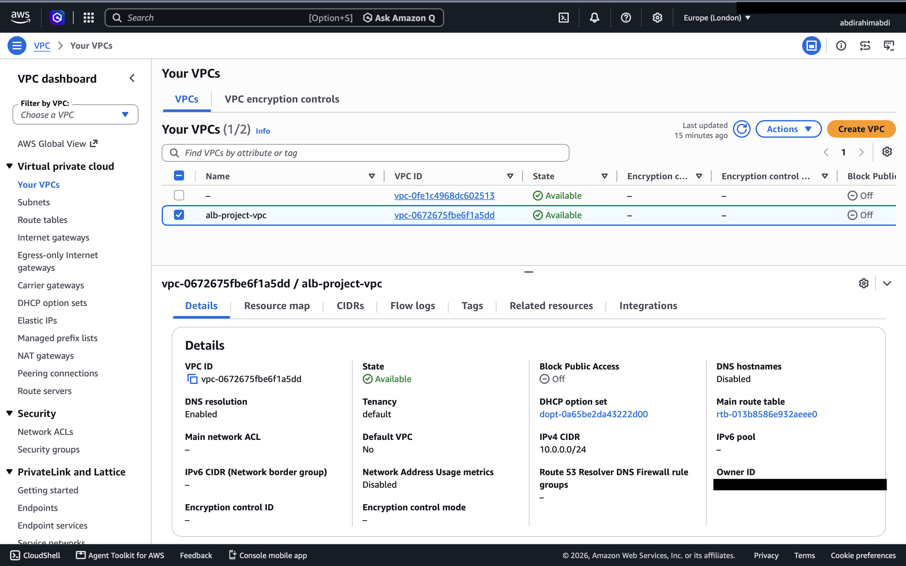

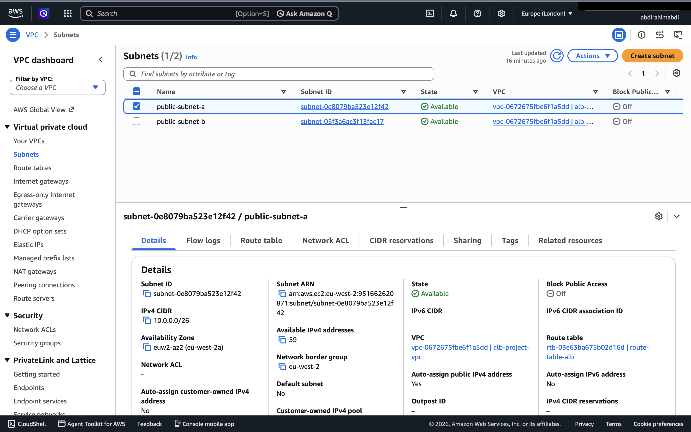

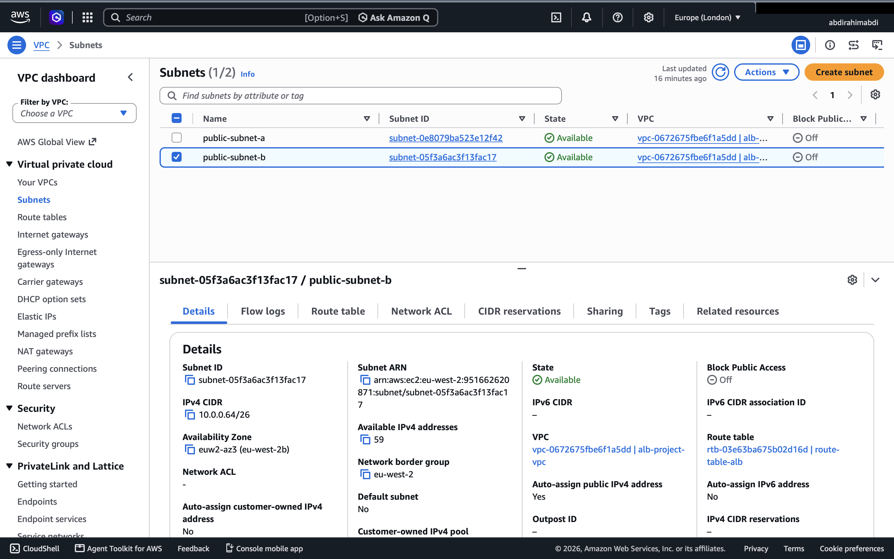

### Making the subnets actually public

This is the bit that's easy to miss with a custom VPC: creating a subnet and calling it "public" doesn't make it public. Out of the box a new VPC has no way to the internet. I had to do three things:

1. **Created and attached an internet gateway** (`my-igw`). This is the VPC's door to the internet.
2. **Created a route table** (`route-table-alb`) with a route sending `0.0.0.0/0` to the internet gateway. Without this route the subnets don't know the door exists.
3. **Associated both subnets with that route table.** Until I did this they were still using the main route table, which has no internet route.

I also turned on **auto-assign public IPv4** for both subnets, so that instances launched there get a public IP and can reach out to download packages during setup.

**Why this matters:** without the internet gateway and route, the ALB wouldn't be reachable from outside, and the EC2 instances couldn't download Apache during boot (so they'd fail health checks and I'd have no idea why).

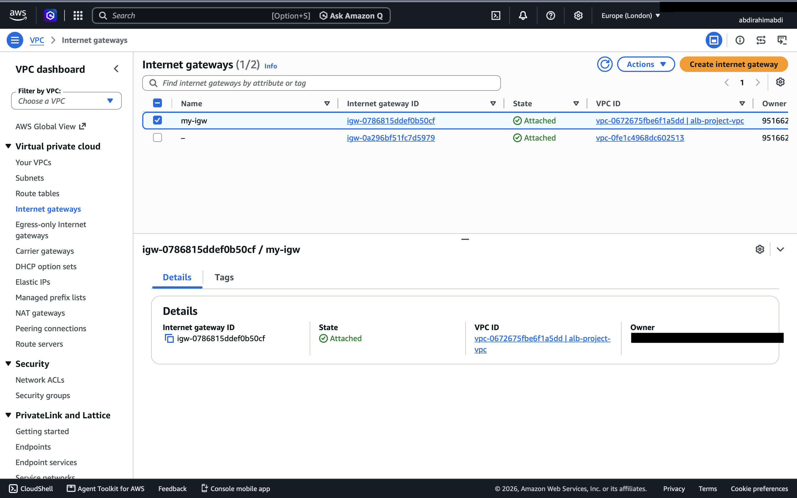

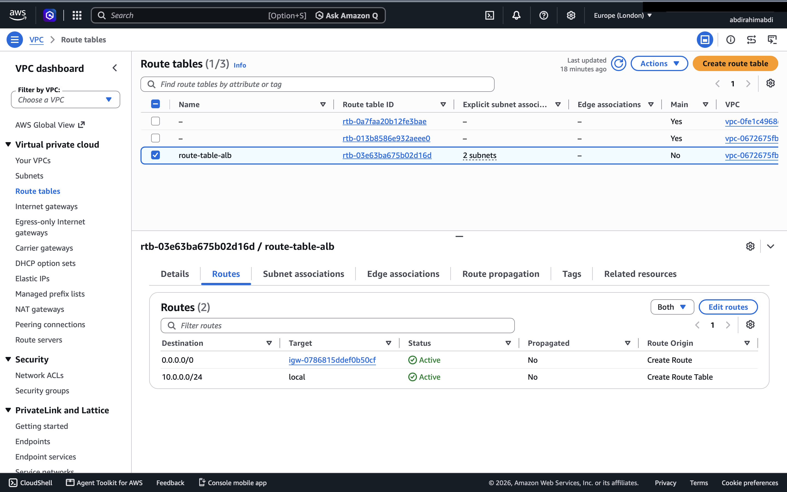

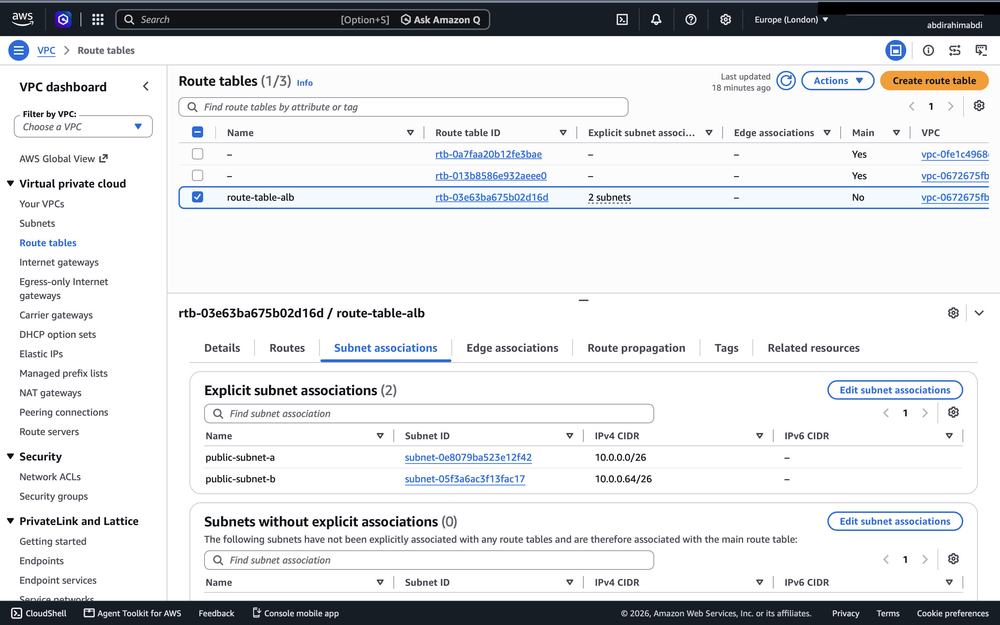

---

## Step 2: Security groups (the part that actually enforces the isolation)

I made two security groups, and the order mattered: ALB first, because the EC2 one refers to it.

### `alb-sg` (for the load balancer)
- **Inbound:** HTTP (port 80) from anywhere.
- The ALB is the public front door, so it has to accept web traffic from the world.

### `ec2-sg` (for the web servers)
- **Inbound:** HTTP (port 80), and the **source is the `alb-sg` security group**, not an IP range.
- Nothing else. No SSH, no "anywhere".

**Why reference a security group instead of an IP range?** It says "only things wearing the ALB's security group can talk to me on port 80". ALB IP addresses change over time, so a CIDR rule would be fragile, whereas a security-group reference always stays correct. It's also what makes this assignment's key requirement true: the instances reject everything that doesn't come through the ALB.

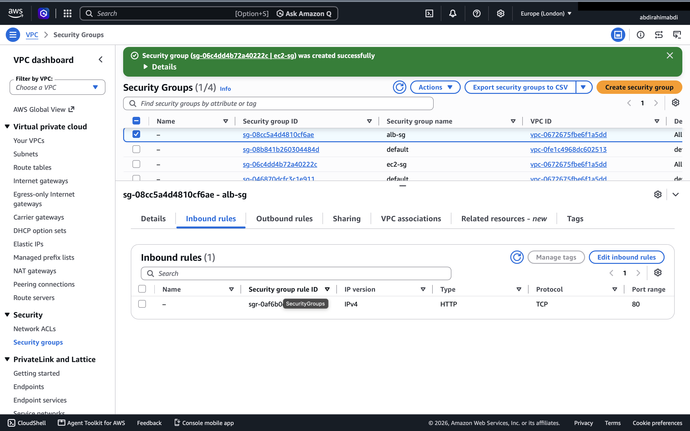

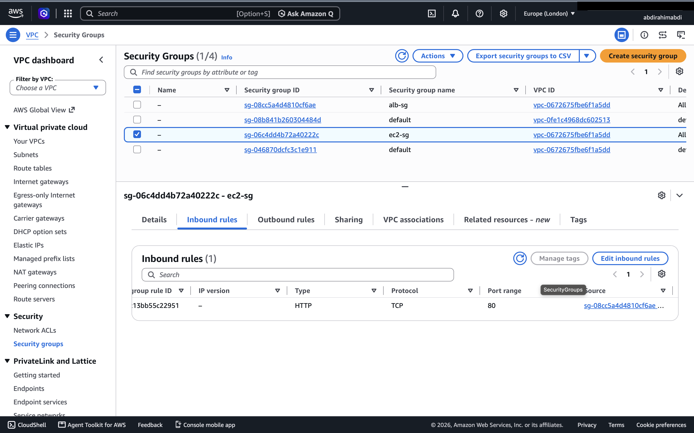

*Note the `sg-...` source on the EC2 one: it points at the ALB's security group, not an IP range.*

---

## Step 3: The two EC2 instances

I launched two `t3.micro` instances on Amazon Linux 2023:

| | web-server-1 | web-server-2 |
|---|---|---|
| Subnet | `public-subnet-a` | `public-subnet-b` |
| AZ | eu-west-2a | eu-west-2b |
| Security group | `ec2-sg` | `ec2-sg` |
| Auto-assign public IP | on | on |
| Key pair | none | none |

**Why different AZs?** So losing one AZ doesn't take the whole site down, and so the ALB has something real to balance across.

**Why public subnets and a public IP if they're not supposed to be public?** The instances need *outbound* internet access to install Apache on first boot. The public IP gives them that. It doesn't make them reachable: `ec2-sg` has no rule letting the internet in, so inbound traffic from anywhere except the ALB is dropped. (The more locked-down production design is private subnets plus a NAT gateway; I skipped it here because NAT costs money and is overkill for this exercise.)

**Why no key pair?** There's no SSH rule anyway, so there's nothing to log in to. Less attack surface.

Both instances have **IMDSv2 required**, which is the safer way for them to read their own metadata. I made sure my user-data scripts use it (see below).

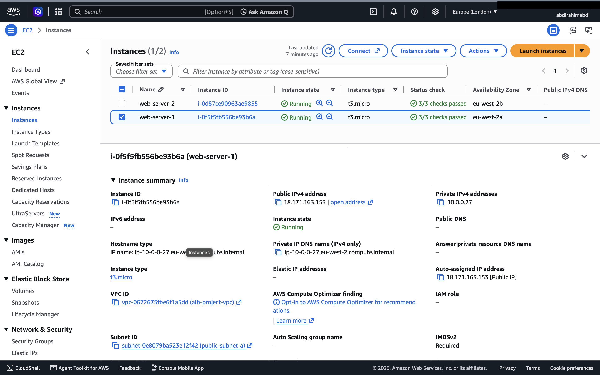

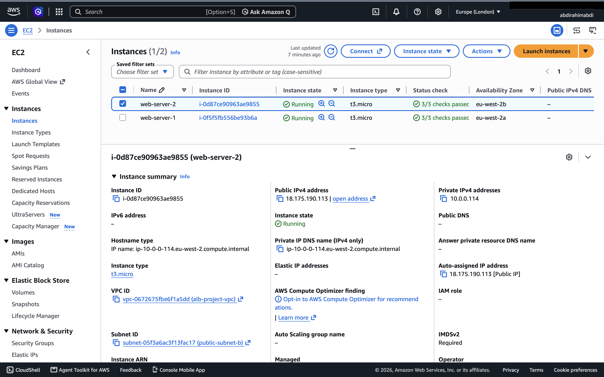

---

## Step 4: User data (what each server does on first boot)

User data is a script that runs automatically the first time the instance boots. I used it to install a web server and write a page that tells me which server answered. Each server gets a different colour and heading so it's obvious when the load balancer switches between them.

### web-server-1

```bash
#!/bin/bash
# User data for Web Server 1 (Amazon Linux 2023)
dnf install -y httpd
systemctl enable --now httpd

# IMDSv2 token, then instance metadata
TOKEN=$(curl -s -X PUT "http://169.254.169.254/latest/api/token" \
  -H "X-aws-ec2-metadata-token-ttl-seconds: 300")
INSTANCE_ID=$(curl -s -H "X-aws-ec2-metadata-token: $TOKEN" \
  http://169.254.169.254/latest/meta-data/instance-id)
AZ=$(curl -s -H "X-aws-ec2-metadata-token: $TOKEN" \
  http://169.254.169.254/latest/meta-data/placement/availability-zone)

cat > /var/www/html/index.html <<EOF
<html>
  <body style="font-family: sans-serif; background: #dbeafe; text-align: center; padding-top: 80px;">
    <h1>Hello from Web Server 1</h1>
    <p>Instance ID: ${INSTANCE_ID}</p>
    <p>Availability Zone: ${AZ}</p>
  </body>
</html>
EOF
```

### web-server-2

Identical, except for the heading and the background colour (`#dcfce7`, a light green) and "Web Server 2":

```bash
#!/bin/bash
# User data for Web Server 2 (Amazon Linux 2023)
dnf install -y httpd
systemctl enable --now httpd

# IMDSv2 token, then instance metadata
TOKEN=$(curl -s -X PUT "http://169.254.169.254/latest/api/token" \
  -H "X-aws-ec2-metadata-token-ttl-seconds: 300")
INSTANCE_ID=$(curl -s -H "X-aws-ec2-metadata-token: $TOKEN" \
  http://169.254.169.254/latest/meta-data/instance-id)
AZ=$(curl -s -H "X-aws-ec2-metadata-token: $TOKEN" \
  http://169.254.169.254/latest/meta-data/placement/availability-zone)

cat > /var/www/html/index.html <<EOF
<html>
  <body style="font-family: sans-serif; background: #dcfce7; text-align: center; padding-top: 80px;">
    <h1>Hello from Web Server 2</h1>
    <p>Instance ID: ${INSTANCE_ID}</p>
    <p>Availability Zone: ${AZ}</p>
  </body>
</html>
EOF
```

---

## Step 5: The target group and health checks

I created a target group called `web-tg`:

- **Target type:** Instances
- **Protocol / port:** HTTP / 80
- **Health check:** HTTP on path `/`
- **Registered targets:** both web servers

**Why a target group?** The ALB doesn't talk to instances directly. It forwards to a target group, which is the list of "who can serve this traffic" and which of them are currently healthy.

**Why a health check on `/`?** The ALB pings each server regularly. If a server stops answering, the ALB quietly stops sending it traffic. I used `/` because the user-data script puts a page there, so a healthy Apache means a successful response.

Both targets went **Healthy**.

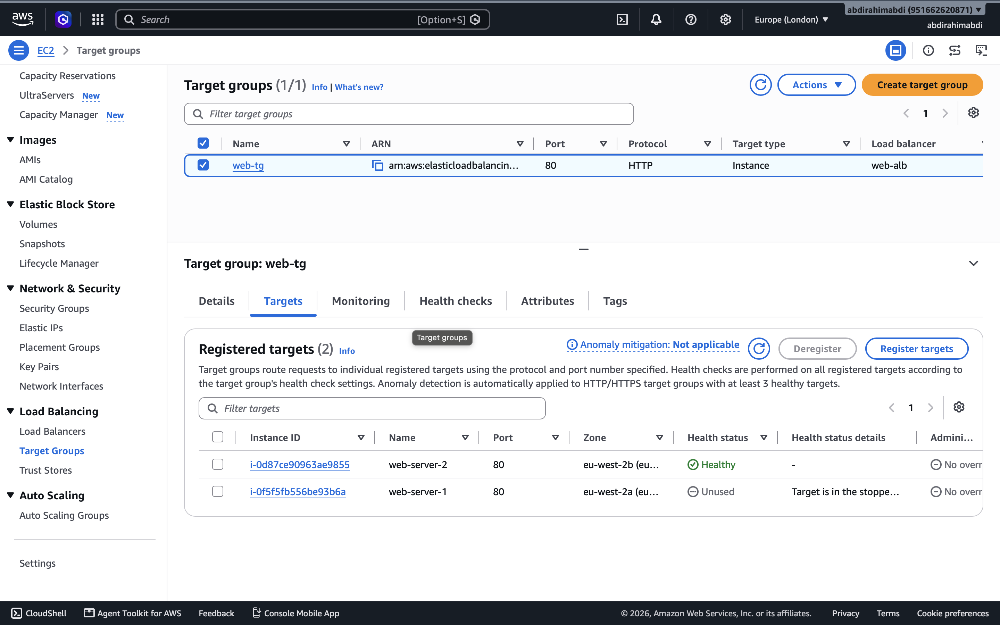

---

## Step 6: The Application Load Balancer

I created `web-alb`:

- **Scheme:** internet-facing (it has to be reachable from the web)
- **IP type:** IPv4
- **Network mapping:** VPC `alb-project-vpc`, with `public-subnet-a` (eu-west-2a) and `public-subnet-b` (eu-west-2b)
- **Security group:** `alb-sg` only (I removed the default one)
- **Listener:** HTTP : 80, default action = forward to `web-tg`

**Why those subnets?** An internet-facing ALB has to live in public subnets (ones with a route to the internet gateway), and it needs two AZs to be highly available.

**Why swap out the default security group?** The default SG doesn't allow inbound web traffic from the internet, so the ALB would've been unreachable. `alb-sg` is the one that opens port 80.

Once the state showed **Active**, AWS gave me a DNS name: `web-alb-1319740665.eu-west-2.elb.amazonaws.com`.

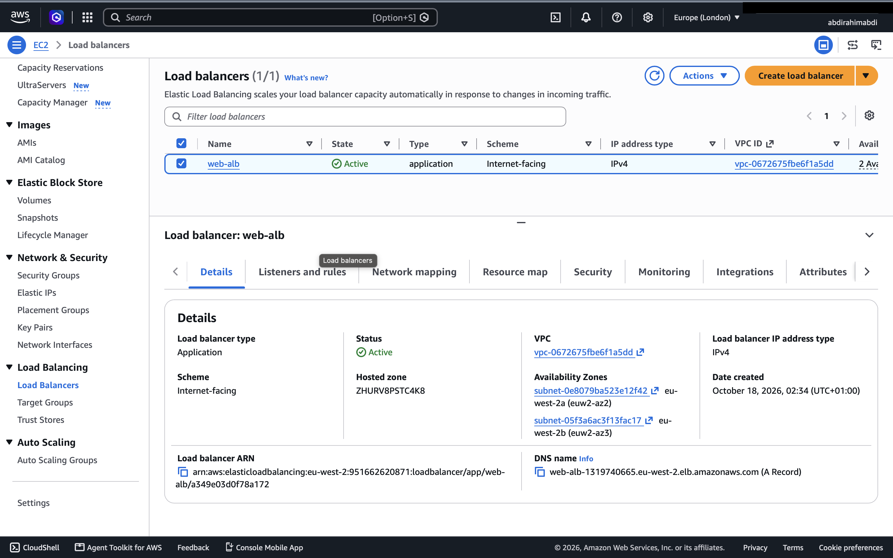

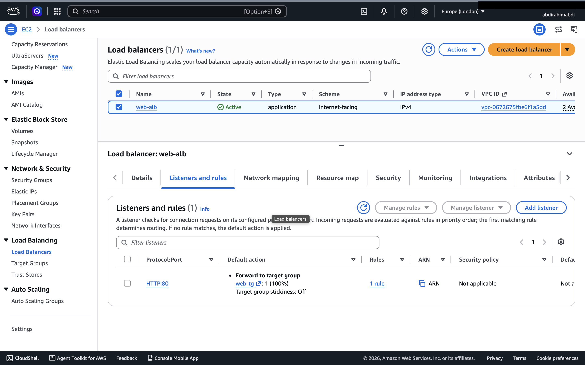

---

## Step 7: Testing

### Does it load, and does it alternate?
I opened the ALB's DNS name in the browser and refreshed. I got the **blue page, "Hello from Web Server 1"** (eu-west-2a), and on another refresh the **green page, "Hello from Web Server 2"** (eu-west-2b). Different instance IDs, different AZs, same URL, so the load balancer is spreading requests across both servers.

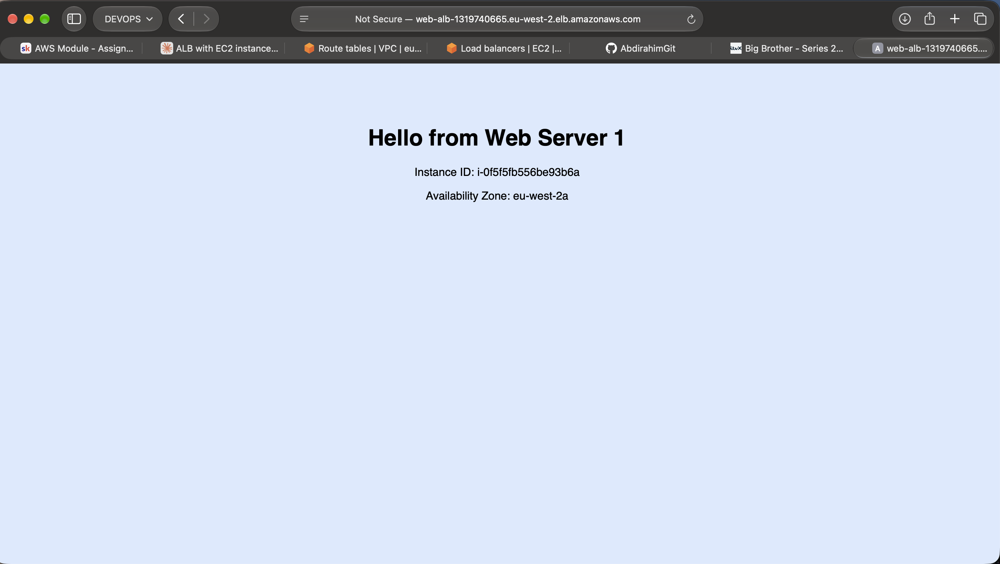

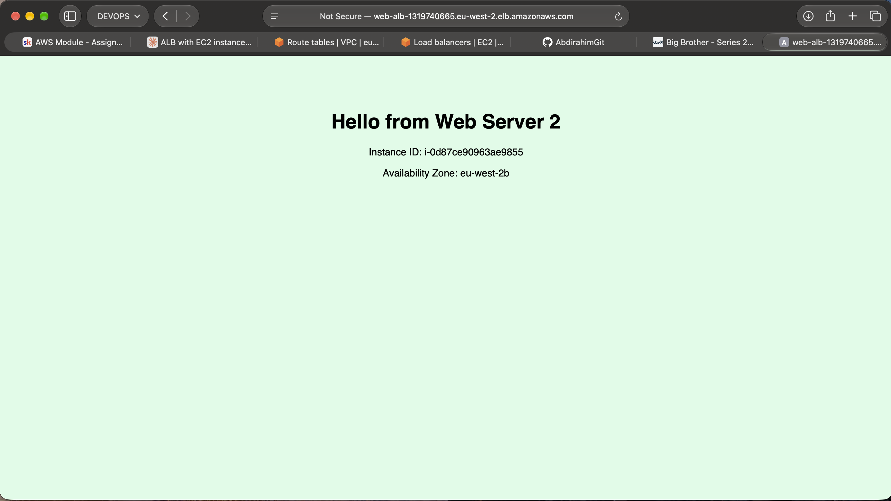

### Are the health checks healthy?
Yes. Both targets in `web-tg` showed **Healthy** (see Step 5).

### Failover test
For fun (and because it proves the health check is doing real work), I **stopped web-server-1** from the EC2 console to see how the ALB would react. I expected it to notice the failed health check, mark that target unhealthy, and send everything to web-server-2.

> **Result:** Once the ALB's health check noticed server 1 had stopped answering, it marked that target unhealthy and quietly stopped sending it traffic. After that, only the green page (Web Server 2) came up, no matter how many times I refreshed. No errors, no manual changes on my side; the ALB just routed around the dead server.

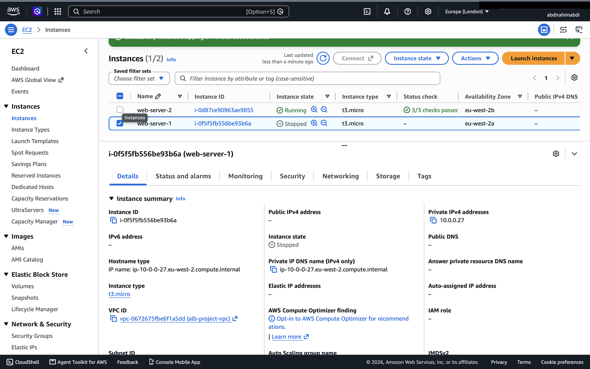

### Direct access should NOT work
The last requirement is that the instances aren't reachable on their own. Hitting an instance's public IP directly should simply time out, because `ec2-sg` only allows traffic from the ALB.

For web-server-1:

```bash
curl -m 5 -v http://3.8.101.6
```

For web-server-2:

```bash
curl -m 5 -v http://18.175.190.113
```

> **Result:** both attempts hung on `Trying <ip>:80...` and then gave up with `curl: (28) Connection timed out after 5006 milliseconds`. No HTML came back from either one.

A timeout (rather than "connection refused") is exactly what I wanted to see. It means the packets are being silently dropped by the security group before they ever reach Apache, so as far as the internet is concerned there's nothing listening. The same pages load fine when I go through the ALB's DNS name, which confirms the ALB is the only way in.

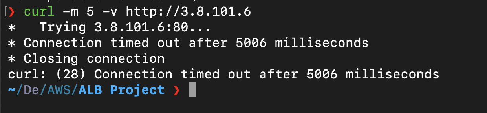

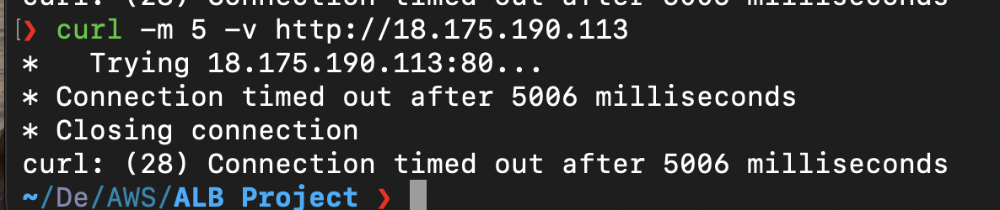

---

## What I learned

- **A subnet is only "public" if its route table points to an internet gateway.** Creating one in a custom VPC doesn't do that for you.
- **Security groups can reference other security groups**, which is a much neater way to say "only the load balancer can talk to me" than juggling IP ranges.
- **The ALB's target group health check is what makes failover automatic.** No manual intervention needed to stop sending traffic to a dead server.
- **Different content per server** is a simple trick that makes load balancing visible.

## What I'd do next (bonus items)

- Point a **Route 53 alias record** at the ALB so there's a friendly domain instead of the long AWS DNS name.
- Add an **HTTPS listener (port 443)** with an ACM certificate, and redirect HTTP to HTTPS.
- Put the web servers in an **Auto Scaling Group** attached to `web-tg`, so instances are replaced and scaled automatically.
- Move the instances to **private subnets with a NAT gateway** for a properly locked-down setup.

## Cleaning up

To avoid charges once I'm done, I delete things in this order: ALB → target group → EC2 instances → security groups (`ec2-sg` before `alb-sg`) → route table, subnets and internet gateway (detach it first) → VPC.